---

### 🐼 ABOUT ME (Hello World!)

- 🎓 4th-year **Software Engineering** student at Hanze University of Applied Sciences, Groningen
- 🛰️ **Product Owner** of [Weather windows & pre-flight go/no-go](https://collabspace.nl/se01-preflight.html), a Softwarelab project for Smart Maintenance at Sea
- 🧩 Internship successfully finished at **De Innovatiespotter**: researched how to move a legacy PHP app to Laravel and built an MVP on their PostgreSQL database
- 🔍 Looking for a **graduation internship** (February 2027) in frontend or full-stack development
- 🎯 Short-term: Frontend Developer · Long-term: Full-stack dev
- 🗂️ I love planning and structure, so I treat my progress like a game: a little EXP every day

---

### 🎒 INVENTORY (what I've worked with)

### 🗺️ NEXT QUESTS (what I'm learning, want to learn)

>> **main quest:** getting really good at one stack, so Laravel + React

>> **side quests:**

### 🧰 TOOLS (extra goodie bag)

---

### 🎮 CLOCK OUT, CHILL OUT (hobbies and interests)

| | |
| --- | --- |
| 🎮 **games** | Wuthering Waves · Baldur's Gate 3 · Stardew Valley · Animal Crossing · Tomodachi Life |
| 📺 **anime** (fantasy forever) | Frieren · Delicious in Dungeon · Witch Hat Atelier |
| 🎨 **art** | pixel art, my newest obsession |
| 🍜 **cooking** | food from all over the world |
| 🧠 **psychology** | especially behavioural psychology |
| | |

---

<picture>
  <source media="(prefers-color-scheme: dark)" srcset="https://raw.githubusercontent.com/FaryBot/FaryBot/output/snake-dark.svg"/>
  <source media="(prefers-color-scheme: light)" srcset="https://raw.githubusercontent.com/FaryBot/FaryBot/output/snake-light.svg"/>
  
</picture>

🐍 the snake above eats my <i>real</i> contributions, so it gets fuller with every commit

### 💌 SAY HI~

✿ Thanks for visiting ✿

